# Auto Cold Email Sender - Application Flowchart

This document details the architectural and execution flow of the **Auto Cold Email Sender** and **LinkedIn 24h Hiring Post & Email Scraper** application.

```mermaid
flowchart TD
    %% Subgraph 1: User Configuration
    subgraph S1["1. Setup & Configuration"]
        A["Start Application (npm start)"] --> B["Open Web UI (http://localhost:3000)"]
        B --> C{"Gmail SMTP Configured?"}
        C -- "No" --> D["Open 'Gmail Settings' Modal<br/>Enter Gmail & 16-Char Google App Password"]
        D --> E["Test SMTP Connection via Nodemailer"]
        E --> F["Credentials Ready (or use Simulation Mode)"]
        C -- "Yes (via .env or Saved)" --> F
    end

    %% Subgraph 2: In-Memory Ingestion & Recruiter Scraping
    subgraph S2["2. Contact Ingestion Modes (Zero-Disk Storage)"]
        F --> G1["Mode A: CSV / Excel Spreadsheet<br/>Drag & drop into memory buffer"]
        F --> G2["Mode B: Email Notepad<br/>Paste raw emails separated by newline"]
        F --> G3["Mode C: LinkedIn 24h Hiring Scraper<br/>Select Boolean query & past 24h filter"]

        G3 --> L1["Interactive Desktop Login / Cookie Verification<br/>(Full 2FA / OTP & Private Post Access)"]
        L1 --> L2["Scrape Hiring Posts Published in Past 24 Hours<br/>(datePosted='past-24h', sortBy='date_posted')"]
        L2 --> L3["Scan post body with regex for Recruiter Emails<br/>(Detects standard RFC + obfuscated [at], (at), [dot])"]
        L3 --> L4["1-Click: 'Send All to Cold Email Queue'"]
        L4 --> G2

        G1 --> H1["SheetJS parses workbook in memory<br/>(Zero files written to hard drive)"]
        H1 --> I1["Auto-detect Email Column & Validate Format"]
        I1 --> J["Contacts ready in memory"]

        G2 --> H2["Regex splits lines & validates emails<br/>(Real-time line, valid, and duplicate counts)"]
        H2 --> J
    end

    %% Subgraph 3: Template & Rules
    subgraph S3["3. Template & Anti-Spam Setup"]
        J --> K["Load Template (Auto-saved to LocalStorage)<br/>(Himanshu's Resume, GitHub, Portfolio, LinkedIn)"]
        K --> L["Optional: Direct Image/PDF Attachment (In-Memory)"]
        L --> M["Set Anti-Spam Delay (3-5s recommended)<br/>& Toggle Duplicate Skipping"]
        M --> N["User clicks 'Start Cold Emailing'"]
    end

    %% Subgraph 4: Execution & Real-Time SSE
    subgraph S4["4. Real-Time Sequential Sending Loop"]
        N --> O["Custom Confirmation Modal<br/>(Review Recipients, Mode, Delay & Sender)"]
        O --> P["POST /api/jobs -> Job created in memory"]
        P --> Q["Browser connects to Server-Sent Events (SSE) Stream"]
        Q --> R{"More recipients in queue?"}
        
        R -- "Yes" --> S["Replace placeholders (e.g. {{Company}})<br/>Convert links to clickable HTML"]
        S --> T["Send Email via Gmail SMTP<br/>(or mock if Dry Run)"]
        T --> U["Stream event to UI: update progress bar,<br/>counter, log terminal, & row badge"]
        U --> V["Wait configured anti-spam delay (e.g. 3s)<br/>with live countdown timer"]
        V --> R
    end

    %% Subgraph 5: Auto-Purge & Cleanup
    subgraph S5["5. Automatic Purge & Reporting"]
        R -- "No (All Sent)" --> W["Campaign Completed!"]
        W --> X["Server deletes all contact row data & attachments from RAM<br/>(delete it.data, delete job.attachment)"]
        X --> Y["Browser resets input & clears memory state"]
        Y --> Z["User can optionally download timestamped CSV report"]
    end

    style S2 fill:#eff6ff,stroke:#3b82f6,stroke-width:2px
    style S3 fill:#fefce8,stroke:#eab308,stroke-width:2px
    style S4 fill:#f0fdf4,stroke:#22c55e,stroke-width:2px
    style S5 fill:#fef2f2,stroke:#ef4444,stroke-width:2px
```

