# Auto Cold Email Sender 🚀

A full-stack web application and automated cold emailing tool built with **Node.js**, **Express**, **Nodemailer**, and **Tailwind CSS**. It enables you to upload recruiter contact lists in **CSV** or **Excel (.xlsx, .xls)** formats and send personalized cold emails for Fullstack Developer roles using Gmail SMTP with built-in anti-spam safeguards.

---

## ✨ Features

- **Dual Input Modes**:
  - **Spreadsheet Mode**: Supports `.csv`, `.xlsx`, and `.xls` files with automatic email column detection and smart column mapping.
  - **Email Notepad Mode**: Blank notepad to paste emails directly separated by new lines (`\n`) with real-time line, valid email, and duplicate counters, plus 1-click Clean, Sample, and Paste tools.
- **Direct Image & Document Attachments**: Attach resume screenshots, portfolio graphics, or PDFs (up to 5MB) processed entirely in-memory with live thumbnail preview.
- **Auto-Saved Templates (LocalStorage)**: Email subject and body changes are automatically remembered in your browser across sessions.
- **Pre-Configured Application Template**: Pre-loaded with Himanshu Narware's Fullstack Developer portfolio, GitHub, LinkedIn, and resume links.
- **Live HTML Preview**: Formats links into clean, clickable HTML hyperlinks and shows attachment previews.
- **Dynamic Personalization**: Automatically replaces placeholders like `{{Company}}` or `{{HR Name}}` using data from your spreadsheet columns.
- **Anti-Spam Safety Controls**:
  - Configurable delay (default: 3–5 seconds) between outgoing emails to protect your Gmail sender reputation.
  - Automatic email deduplication (prevents emailing the same address twice).
  - Safe Simulation Mode (Dry Run) to test campaigns without sending real emails.
- **Zero-Disk Storage & In-Memory Privacy**: Neither contacts nor attachments are saved to disk; all data is immediately purged from RAM upon campaign completion.
- **Real-Time Progress & SSE Streaming**: Live status dashboard displaying queued, sent, and failed counters, animated progress bar, countdown timers, real-time activity log, and per-contact badges.
- **Exportable Reports**: One-click download of timestamped CSV execution reports with message IDs and delivery statuses.
- **Flexible SMTP Setup**: Configure credentials via `.env` file or directly in the UI with an instant connection tester.

---

## 🔄 Application Architecture & Flowchart

The following flowchart illustrates the entire lifecycle of the application—from spreadsheet upload and in-memory parsing, through the sequential anti-spam sending engine, to automatic data purging upon completion:

```mermaid
flowchart TD
    %% Subgraph 1: User Configuration
    subgraph S1["1. Setup & Configuration"]
        A["Start Application (npm start)"] --> B["Open Web UI (http://localhost:3000)"]
        B --> C{"Gmail SMTP Configured?"}
        C -- "No" --> D["Open 'Gmail Settings' Modal<br/>Enter Gmail & 16-Char Google App Password"]
        D --> E["Test SMTP Connection via Nodemailer"]
        E --> F["Credentials Ready (or use Simulation Mode)"]
        C -- "Yes (via .env or Saved)" --> F
    end

    %% Subgraph 2: In-Memory Ingestion
    subgraph S2["2. Zero-Disk In-Memory Ingestion"]
        F --> G["Drag & Drop CSV / XLSX File"]
        G --> H["Multer reads file into RAM Buffer<br/>(ZERO files written to hard drive)"]
        H --> I["SheetJS parses workbook in memory"]
        I --> J["Auto-detect Email Column & Validate Emails"]
        J --> K["UI displays preview table & valid email count"]
    end

    %% Subgraph 3: Template & Rules
    subgraph S3["3. Template & Anti-Spam Setup"]
        K --> L["Pre-filled Cold Email Template Loaded<br/>(Himanshu's Resume, GitHub, Portfolio, LinkedIn)"]
        L --> M["Set Anti-Spam Delay (3-5s recommended)<br/>& Toggle Duplicate Skipping"]
        M --> N["User clicks 'Start Cold Emailing'"]
    end

    %% Subgraph 4: Execution & Real-Time SSE
    subgraph S4["4. Real-Time Sequential Sending Loop"]
        N --> O["Custom Confirmation Modal<br/>(Review Recipients, Mode, Delay & Sender)"]
        O --> P["POST /api/jobs -> Job created in memory"]
        P --> Q["Browser connects to Server-Sent Events (SSE) Stream"]
        Q --> R{"More recipients in queue?"}
        
        R -- "Yes" --> S["Replace placeholders (e.g. {{Company}})<br/>Convert links to clickable HTML"]
        S --> T["Send Email via Gmail SMTP<br/>(or mock if Dry Run)"]
        T --> U["Stream event to UI: update progress bar,<br/>counter, log terminal, & row badge"]
        U --> V["Wait configured anti-spam delay (e.g. 3s)<br/>with live countdown timer"]
        V --> R
    end

    %% Subgraph 5: Auto-Purge & Cleanup
    subgraph S5["5. Automatic Purge & Reporting"]
        R -- "No (All Sent)" --> W["Campaign Completed!"]
        W --> X["Server deletes all spreadsheet row data from RAM<br/>(delete it.data)"]
        X --> Y["Browser resets file input & clears memory state"]
        Y --> Z["User can optionally download timestamped CSV report"]
    end

    style S2 fill:#eff6ff,stroke:#3b82f6,stroke-width:2px
    style S4 fill:#f0fdf4,stroke:#22c55e,stroke-width:2px
    style S5 fill:#fef2f2,stroke:#ef4444,stroke-width:2px
```



---

## 📋 Default Email Template

**Subject:**
> Applying for the Fullstack Developer role

**Body:**
> Dear HR,
>
> I am writing to express my interest in the Fullstack Developer position at your company.
>
> I am a Fullstack Developer with 1.6 years of experience in building scalable applications. I have pasted my resume and profile for your review, as I believe my skills and background would be a strong fit for your team.
>
> Thank you for your time and consideration. I look forward to hearing from you.
>
> Best regards,  
> **Himanshu Narware**  
>
> Resume: https://shorturl.at/jucRH  
> Github: https://github.com/HimanshuNarware  
> Portfolio: https://himanshunarwaresde-one.vercel.app/  
> LinkedIn: https://www.linkedin.com/in/himanshunarware/  

*(The subject and body are fully editable in the UI before sending.)*

---

## 🛠️ Quick Start

### 1. Install Dependencies
```bash
npm install
```

### 2. Configure Gmail SMTP (2 Options)

#### Option A: Project `.env` file (Recommended)
Edit the `.env` file in the project root:
```env
PORT=3000
GMAIL_USER=your_email@gmail.com
GMAIL_APP_PASSWORD=xxxx xxxx xxxx xxxx
DEFAULT_DELAY_SECONDS=3
```

#### Option B: Directly in the Web UI
Click **"Gmail Settings"** in the top navigation bar, enter your credentials, and click **"Test Connection"**.

> **Note on Google App Password:**  
> 1. Go to your [Google Account Security](https://myaccount.google.com/security) page.
> 2. Ensure **2-Step Verification** is enabled.
> 3. Go to [App Passwords](https://myaccount.google.com/apppasswords).
> 4. Create an App named `"Auto Cold Sender"`.
> 5. Copy the 16-character code (e.g. `abcd efgh ijkl mnop`) and use it as your password.

---

### 3. Run the Application

```bash
# Production mode
npm start

# Development mode (with auto-reload)
npm run dev
```

Open your browser at **`http://localhost:3000`**.

---

## 📁 Sample Contact Files Included

You can test the application immediately using the included sample files or by clicking the sample download buttons in the UI:
- [`sample_contacts.csv`](./sample_contacts.csv)
- [`sample_contacts.xlsx`](./sample_contacts.xlsx)

---

## 🛡️ Anti-Spam Best Practices

1. **Keep Delay at 3–5 seconds**: Gives Gmail's SMTP servers breathing room and mimics human sending behavior.
2. **Stay within Gmail Daily Sending Limits**:
   - Free Gmail accounts: ~100–500 emails/day
   - Google Workspace accounts: ~2,000 emails/day
3. **Run a Dry Run First**: Check the **"Simulation Mode (Dry Run)"** box to test your spreadsheet and template risk-free.
